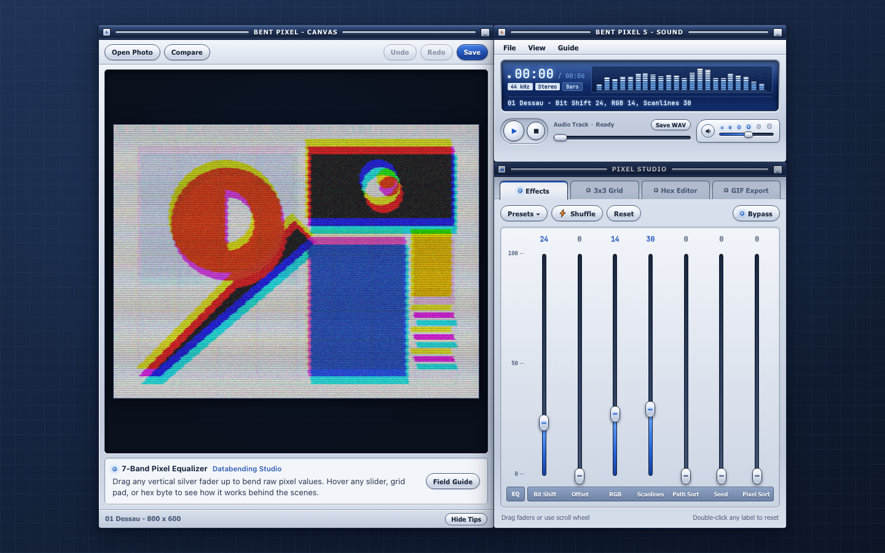

# Bent Pixel Lab

A browser-based glitch art and databending studio inspired by early-2000s desktop media players. Every image, hex byte, animated GIF, and stereo WAV file is processed 100% locally in your browser with zero uploads.

Built with vanilla HTML, CSS, ES modules, HTML5 Canvas, and the Web Audio API. This project aims to make experimental databending techniques accessible and understandable while honoring the artistic and technical heritage of glitch art.

Special thanks to the global glitch art community for openly sharing techniques, tools, and knowledge that made this project possible.



## Features

- **7-Band Pixel Equalizer (Effects)**
  - Sequential effect chain with vertical tactile faders, scroll-wheel support, and Paint-Across curve drawing across all 7 bands
  - Bit Shift, Data Offset, RGB Split, Scanlines, Path Sort, Seed Growth, and Pixel Sort
  - Non-destructive Bypass switch, Shuffle randomizer, 12 built-in presets, persistent custom presets in `localStorage`, and shareable `#eq=` URL hashes

- **3x3 Spatial Grid**
  - Click or drag directly across the canvas to apply localized effects to individual 3x3 regions
  - 6 stackable grid processors: Pixel Flow, Vortex, Shatter, Ripple, Neon Pulse, and Prism Split

- **Native JPEG Hex Editor**
  - Inspect and edit the live compressed bytes of a real JPEG stream with automatic segment parsing (`SOI`, `APP`, `DQT`, `SOF0`, `DHT`, `SOS`, `Scan Data`, `EOI`)
  - Header Lock keeps edits inside safe picture scan data, or toggle it off to trigger and recover from real decode faults with one-click Header Repair
  - Built-in Transpose, Invert, and Smear databending operators plus a live horizontal scanline probe across the canvas

- **Animated GIF89a Export**
  - Pure-JavaScript GIF89a encoder with 256-color Median Cut quantization, LZW compression, and looping `NETSCAPE2.0` animation
  - Four live-preview animation modes (Sweep, Pulse, Hex Drift, Strobe) with adjustable frame count (6-20) and playback speed (4-20 FPS)

- **Image Sonifier & 16-Bit Stereo WAV Export**
  - Translates bent pixels into live 44.1 kHz stereo Web Audio playback with a synesthetic scan playhead across the artwork
  - Clickable glowing LCD spectrum analyzer cycling through Bars, Mirror, and Wave visualizers
  - Pure-JavaScript 16-bit Stereo PCM RIFF/WAVE encoder (`Save WAV` or `File -> Export Audio (.wav)`)

- **Desktop Window Rig & 5 Color Themes**
  - Draggable desktop windows (`Canvas`, `Sound`, `Pixel Studio`, and floating `Field Guide`) with 16px magnetic edge snapping, Windowshade collapse (`_` or titlebar double-click), and one-click layout reset
  - 5 authentic Winamp-inspired Color Themes (`Classic Silver`, `Carbon Dark`, `Alpine Olive`, `Amber CRT`, `Classic Green`) persisted in `localStorage`
  - Responsive 2-column tablet layout and single-column mobile stack with an adaptive 4-byte-per-row Hex Editor

- **Live Learning Bar & Field Guide**
  - Fixed-height contextual Learning Bar explaining every slider, grid effect, hex segment, and export tool in plain language as you explore
  - Floating Field Guide with an interactive clickable JPEG Anatomy Strip that jumps straight to matching bytes in the Hex Editor, a 1965-2012 glitch art timeline, and live Guided Recipes

- **Workflow & Export**
  - 3 built-in high-contrast procedural artworks (`01 Dessau`, `02 Alpine Ridge`, `03 Chroma Prism`), drag-and-drop image loading, and `Cmd/Ctrl+V` clipboard paste
  - 25-step unified Undo/Redo (`Cmd/Ctrl+Z`, `Cmd/Ctrl+Shift+Z`)
  - Dual-mode Compare: hold `Space` or press the canvas to peek at the original, or drag horizontally in Effects/Hex mode for a live `Original | Bent` Split Curtain
  - Export PNG, JPG (preserving raw mutated JPEG bytes in Hex mode), animated GIF, stereo WAV, or copy PNG directly to the clipboard

## Getting Started

### Prerequisites
- Any modern browser with HTML5 Canvas, ES Modules, and Web Audio API support (Safari, Chrome, Firefox)

### Running Locally
Because the studio loads native ES modules (`<script type="module">`), serve the directory over a local HTTP server:

```bash
# From the repository root (serves /fonts/ and /pixel/)
python3 -m http.server 8000
```

Then open `http://localhost:8000/pixel/`.

## Effect Descriptions

### Classic Effects
- **Bit Shift**: Rotates the bits inside each RGB color byte sideways, causing hues to wrap like misread video RAM.
- **Offset**: Slides raw pixel memory forward with alternating band shear, recreating frame-buffer shifts and VHS tracking slip.
- **RGB Split**: Separates red, green, and blue channels diagonally like misaligned CRT electron beams.
- **Scanlines**: Darkens alternating horizontal lines with subtle signal jitter to mimic vintage CRT displays.
- **Path Sort**: Sorts pixels by brightness inside sliding horizontal tiles for woven contour textures.
- **Seed Growth**: Identifies bright highlight pixels as seeds and blooms their color outward across neighbors.
- **Pixel Sort**: Sorts horizontal pixel spans below a brightness threshold dark-to-light for painterly streaks.

### 3x3 Grid Effects
- **Pixel Flow**: Displaces pixels outward along smooth sine-wave currents inside each active cell.
- **Vortex**: Twists pixels around the zone center using polar coordinate warping.
- **Shatter**: Splits each active tile into jagged offset shards with chromatic edge boost.
- **Ripple**: Radiates concentric sine waves outward from the tile center.
- **Neon Pulse**: Boosts mid-tones and edges with a glowing gamma curve.
- **Prism Split**: Samples red, green, and blue at three opposing radial angles around the zone center.

## License

This project is licensed under the MIT License - see the [LICENSE](LICENSE) file for details.

## Acknowledgments

### Historical Influences & Credits

This project stands on the shoulders of pioneers in glitch art and databending:

#### Pioneers
- **Nam June Paik** (1965) - Created "TV Magnet", one of the first deliberate manipulations of electronic media for artistic purposes
- **Jamie Fenton & Raul Zaritsky** (1978) - Created "Digital TV Dinner", a groundbreaking early example of intentional video manipulation
- **JODI** (Joan Heemskerk & Dirk Paesmans) - Pioneered net.art and early digital glitch aesthetics in the 1990s
- **Kim Cascone** (2000) - Coined "post-digital" aesthetics and explored glitch in computer music
- **Rosa Menkman** (2010) - Author of the "Glitch Studies Manifesto" and "The Glitch Moment(um)", fundamental texts in glitch art theory
- **Kim Asendorf** (2012) - Popularized brightness-interval Pixel Sorting in digital glitch art

#### Shoutouts
- Michael Betancourt's "Glitch Art in Theory and Practice"
- Rosa Menkman's research on glitch aesthetics
- GLI.TC/H community
